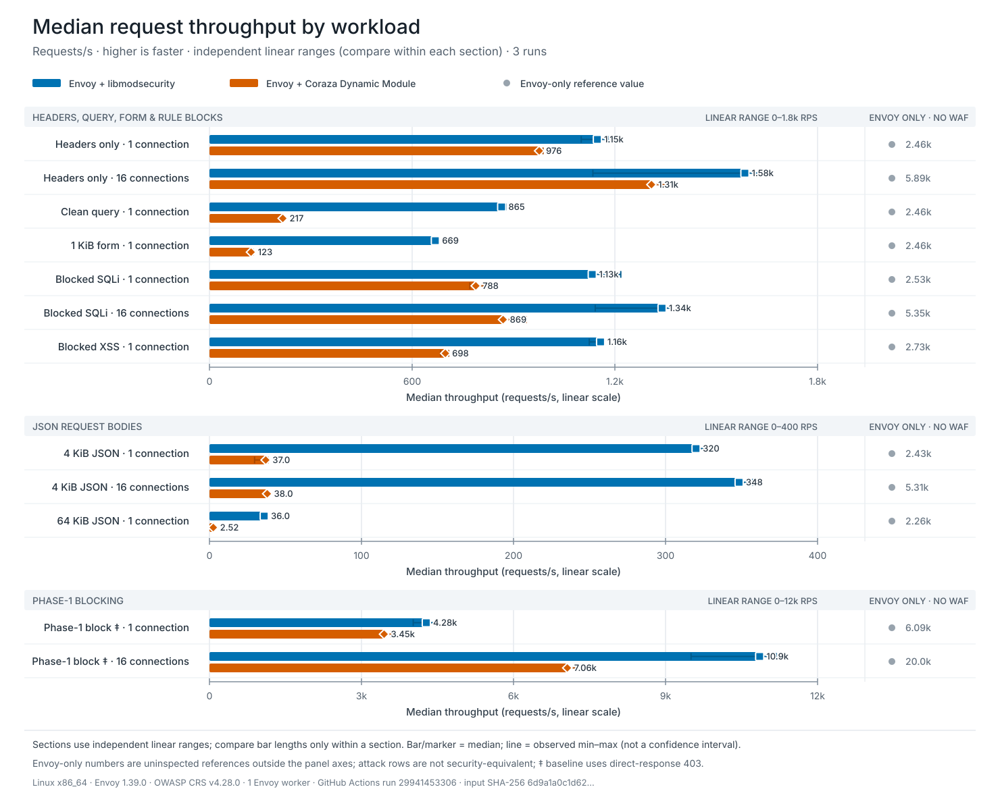
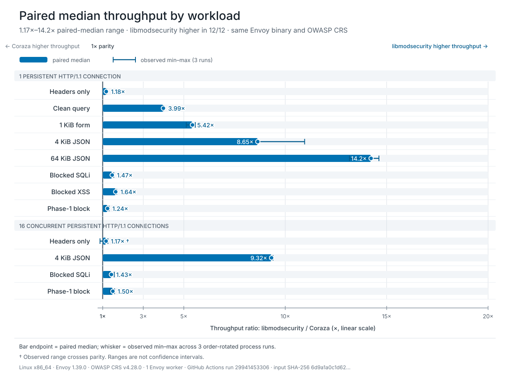
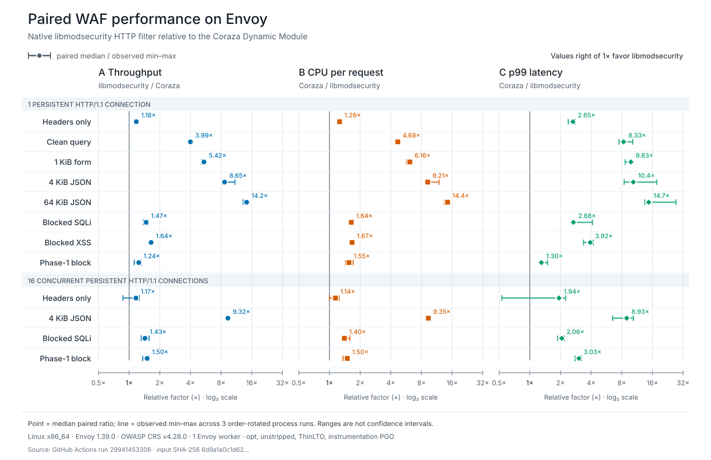

# Envoy WAF performance report

This report summarizes one controlled Linux x86_64 comparison of the complete Envoy integration
paths for this repository's libmodsecurity filter and the Coraza Dynamic Module. It is an
integration benchmark, not an isolated regular-expression engine microbenchmark or a universal
ranking.

<p align="center">
  
</p>

In this run, the libmodsecurity median was higher in all 12 workloads. The figure reports actual
requests per second rather than a normalized score. Each section has its own explicitly labeled
linear range, so compare bar lengths only within the same section.

## Reading the figure

- Bars and endpoint markers show the median of three order-rotated process runs.
- Thin lines show the observed minimum and maximum, not a confidence interval.
- Blue and orange bars have equal visual weight and start at zero on their section's linear axis.
- Envoy-only values are listed outside the axes because they disable WAF inspection and would
  otherwise dominate the inspected-engine scale.
- The one-connection and 16-connection labels mean concurrent persistent HTTP/1.1 client
  connections. Envoy itself runs with one worker in both cases.

## Test environment

| Item | Recorded value |
| --- | --- |
| Source run | [GitHub Actions run 29941453306](https://github.com/upgle/envoy-modsecurity/actions/runs/29941453306) |
| Source job | [Linux comparison job 88996163525](https://github.com/upgle/envoy-modsecurity/actions/runs/29941453306/job/88996163525) |
| Generated | `2026-07-22T20:21:27.285060+00:00` |
| Project commit | [`6c396c920970bc4d09b7a2f1c8b14b4f7775eaba`](https://github.com/upgle/envoy-modsecurity/commit/6c396c920970bc4d09b7a2f1c8b14b4f7775eaba) |
| Project tree | `9900d4510fa8fdc1e81956fc3d7e82b41c6f2b0d` |
| Source archive | [`benchmark/waf-linux-2026-07-22`](https://github.com/upgle/envoy-modsecurity/tree/benchmark/waf-linux-2026-07-22) |
| Platform | Linux `6.17.0-1020-azure`, x86_64, glibc 2.41 |
| Envoy | 1.39.0 at [`8eea3285d6bd`](https://github.com/envoyproxy/envoy/commit/8eea3285d6bdb89f8ea34632cfe7ce1608a8f374), one worker pinned to CPU 0 |
| Build profile | Bazel `opt`, Fission disabled, ThinLTO, LLVM instrumentation PGO, `--strip=never` |
| libmodsecurity | 3.0.16 at [`7ea9fefbe0ba`](https://github.com/owasp-modsecurity/ModSecurity/commit/7ea9fefbe0ba409d8733b4d682c8c4c059cd028d) |
| Coraza Dynamic Module | Built On Envoy 0.6.2 at [`82b1f9357429`](https://github.com/tetratelabs/built-on-envoy/commit/82b1f9357429aa171d6788a4901db54033f1dd00) |
| Coraza engine | 3.7.0 |
| Go toolchain | 1.26.4, pinned by the Built On Envoy release |
| OWASP CRS | 4.28.0 at [`55b09f5acfd1`](https://github.com/coreruleset/coreruleset/commit/55b09f5acfd16413e7b31041100711ceb7adc89c) |
| Connector patch SHA-256 | `558d0e5c6e039472828c27c3fac8ded2987d2f026b13b8bd4a5be9e3ca41918e` |
| Repeats | Three order-rotated measurement runs |
| Client topology | 16 client processes pinned across CPUs 1, 2, and 3 |
| Request scale | 1.0 |
| Raw benchmark JSON SHA-256 | `6d9a1a0c1d62ab49b99e883dd3c5f1e36e574d18b18fba9382c8a4afea51eef1` |

The comparison target registers the baseline, native filter, and Dynamic Module in the same Envoy
executable. Both inspected modes load the same generated SecLang root and local CRS rule files.
Request inspection is enabled at blocking paranoia level 1. Response inspection, audit logging,
access logging, and native server logging are disabled.

The raw result's free-form `build_profile` field incorrectly says `stripped`. The archived
[build manifest](waf-engine-comparison-linux-build-manifest.txt) records the actual final flag,
`--strip=never`, and is authoritative for this run. The renderer applies that correction explicitly,
and the workflow label is corrected for subsequent runs.

## Workloads

All requests use a loopback listener and a minimal loopback HTTP/1.1 upstream. The applicable
expected status is validated for every request.

| Workload | Request | Connections | Requests per run | Envoy only | Inspected |
| --- | --- | ---: | ---: | ---: | ---: |
| Headers only | `GET /safe` | 1 | 600 | 200 | 200 |
| Clean query | Benign query-string arguments | 1 | 400 | 200 | 200 |
| 1 KiB form | URL-encoded POST body | 1 | 300 | 200 | 200 |
| 4 KiB JSON | JSON POST body | 1 | 250 | 200 | 200 |
| 64 KiB JSON | JSON POST body | 1 | 50 | 200 | 200 |
| Blocked SQLi | URL-encoded SQL injection body | 1 | 150 | 200 | 403 |
| Blocked XSS | XSS query-string payload | 1 | 150 | 200 | 403 |
| Phase-1 block | Header-triggered phase-1 rule | 1 | 6,000 | 403 | 403 |
| Headers only | `GET /safe` | 16 | 1,200 | 200 | 200 |
| 4 KiB JSON | JSON POST body | 16 | 600 | 200 | 200 |
| Blocked SQLi | URL-encoded SQL injection body | 16 | 400 | 200 | 403 |
| Phase-1 block | Header-triggered phase-1 rule | 16 | 12,000 | 403 | 403 |

The phase-1 Envoy-only reference uses a direct-response 403 route so all three modes return the
expected status. That reference is useful for transport overhead but is not security-equivalent to
either inspected path.

## Method

The Linux workflow performs the following sequence:

1. Build the comparison Envoy target with Bazel `opt`, Fission disabled, and ThinLTO.
2. Instrument the C++ target and train the baseline, libmodsecurity, and Dynamic Module paths.
3. Merge the LLVM raw profiles and rebuild the same target with profile-guided optimization.
4. Warm each process with 100 `GET /safe` requests at eight client connections, then measure the
   complete listener, filter, ruleset, and upstream path.
5. Rotate the three engine orders as baseline/native/Dynamic Module,
   Dynamic Module/baseline/native, and native/Dynamic Module/baseline.
6. Record throughput, latency percentiles, Envoy CPU, startup time, RSS, response validation, and
   native filter terminal gauges.
7. Run a separate phase-1 diagnostic with native stage timers and Linux `perf`.

The native C++ filter and its static libmodsecurity dependency receive the LLVM instrumentation and
profile-use cycle. The separately built Go shared library retains the upstream release's optimized
build settings. This difference is part of the tested deployment artifacts and should not be read
as an isolated language-runtime comparison.

## Median throughput

Values below are actual median requests per second from the plotted snapshot.

| Workload | Connections | Envoy only | libmodsecurity | Coraza |
| --- | ---: | ---: | ---: | ---: |
| Headers only | 1 | 2463.35 | 1148.23 | 976.12 |
| Clean query | 1 | 2463.40 | 864.98 | 217.08 |
| 1 KiB form | 1 | 2462.05 | 668.67 | 123.27 |
| 4 KiB JSON | 1 | 2434.23 | 320.09 | 37.02 |
| 64 KiB JSON | 1 | 2262.44 | 36.04 | 2.52 |
| Blocked SQLi | 1 | 2527.04 | 1133.13 | 788.45 |
| Blocked XSS | 1 | 2727.31 | 1157.80 | 698.32 |
| Phase-1 block | 1 | 6089.73 | 4279.43 | 3446.80 |
| Headers only | 16 | 5891.81 | 1584.98 | 1308.35 |
| 4 KiB JSON | 16 | 5309.92 | 348.41 | 38.03 |
| Blocked SQLi | 16 | 5353.74 | 1339.78 | 869.30 |
| Phase-1 block | 16 | 19962.17 | 10857.61 | 7062.47 |

The large Envoy-only values do not represent equivalent security behavior. Attack rows bypass WAF
inspection in that mode, and the phase-1 row follows the direct-response path described above.

## Paired-run detail

The ratio plot is included as technical supporting evidence rather than the headline result. It
uses the median of per-run paired ratios, which can differ slightly from dividing the aggregate
median values in the table.

<p align="center">
  
</p>

The paired median ranges from 1.17× to 14.2×. Eleven observed throughput ranges remain above
parity. The `headers_c16` range crosses parity, with two of three paired runs favoring
libmodsecurity, so its median should not be presented as a stable universal advantage.

### CPU and p99 latency

<p align="center">
  
</p>

These panels use paired ratios to put metrics with different units on a common view. Their whiskers
are observed three-run ranges, not confidence intervals.

## Interpretation boundaries

- This is one GitHub-hosted Linux runner, not dedicated benchmark hardware.
- The runner's CPU model and VM SKU were not recorded, which limits hardware-level reproduction.
- Three repeats are sufficient for a reproducible CI snapshot but not for publication-grade
  confidence intervals. More repeats, CPU isolation, and order randomization are required for a
  stronger statistical claim.
- The 64 KiB JSON workload contains only 50 requests per process run, so startup noise and
  short-duration effects can have more influence than in the longer phase-1 workloads.
- `headers_c16` shows material native run-to-run variation and a paired range that crosses parity.
- The result includes each connector or module's complete Envoy integration overhead. It does not
  isolate only rule evaluation, PCRE2, Go, C++, allocation, or ABI overhead.
- The PGO workload trains the common Envoy path and all three modes. Only the C++ target and static
  native dependency consume the merged LLVM profile.
- Workloads are synthetic and use a minimal upstream. Production traffic mixes, exclusions,
  request bodies, hardware, worker counts, and overload behavior can change the result.
- Response inspection, audit logging, persistent collections, and external I/O are outside this
  comparison.
- Envoy-only attack rows are not security-equivalent to either WAF integration.

## Reproduce and audit

The committed evidence and generator are:

- [Raw comparison result](waf-engine-comparison-linux-raw.json)
- [Normalized plotted data](waf-engine-comparison-linux.json)
- [Phase-1 stage-timing result](waf-phase1-profile-linux.json)
- [Archived Linux perf text reports](perf/README.md)
- [Build manifest and artifact hashes](waf-engine-comparison-linux-build-manifest.txt)
- [Chart renderer](../../tools/render-waf-performance-chart.py)
- [Linux workflow](../../.github/workflows/waf-engine-comparison.yml)
- [CI build and profiling orchestration](../../tools/ci-waf-engine-comparison.sh)
- [Benchmark runner](../../tools/waf-engine-comparison.py)
- [Benchmark build and local-run guide](../../test/performance/envoy_dynamic_comparison/README.md)
- [Source workflow run](https://github.com/upgle/envoy-modsecurity/actions/runs/29941453306)

The raw comparison result is preserved because the source Actions artifact expires. The source
archive tag preserves the exact measured project commit and tree independently of the pull-request
branch history. Verify and regenerate every chart and the normalized snapshot with:

```shell
printf '%s  %s\n' \
  '6d9a1a0c1d62ab49b99e883dd3c5f1e36e574d18b18fba9382c8a4afea51eef1' \
  docs/performance/waf-engine-comparison-linux-raw.json |
  sha256sum --check

python3 tools/render-waf-performance-chart.py \
  docs/performance/waf-engine-comparison-linux-raw.json \
  --output docs/images/waf-throughput-speedup.svg \
  --absolute-output docs/images/waf-absolute-throughput.svg \
  --detail-output docs/images/waf-engine-comparison.svg \
  --snapshot docs/performance/waf-engine-comparison-linux.json \
  --source-url https://github.com/upgle/envoy-modsecurity/actions/runs/29941453306 \
  --build-profile-override \
    'Linux x86_64 Bazel opt, unstripped, ThinLTO, instrumentation PGO'
```

After the workflow has been merged to the default branch, request a new end-to-end Linux build,
PGO training cycle, comparison, and phase-1 profile for a selected ref with:

```shell
gh workflow run waf-engine-comparison.yml \
  --repo upgle/envoy-modsecurity \
  --ref BRANCH_OR_TAG \
  --field repeats=3 \
  --field request_scale=1 \
  --field pgo_training_request_scale=1 \
  --field profile_request_scale=50
```

The workflow is expensive and intentionally is not a pull-request gate. The recorded source run
was triggered by a branch push and used the effective parameters shown above. For a local build or
custom module path, follow the benchmark guide rather than copying the CI container commands.

## Relationship to release qualification

This report is separate from
[`make qualification-benchmark`](../development.md#qualification-benchmark):

| Property | This comparison | Release qualification |
| --- | --- | --- |
| Purpose | Compare three complete Envoy paths | Check this project's release safety floors |
| Modes | Envoy only and two inspected integrations | This project's custom Envoy binary |
| Envoy workers | 1 | 4 |
| Repetition | Three order-rotated process runs | Threshold-enforced qualification run |
| Special coverage | Cross-integration workload comparison | Pathological regex, soak, RSS, and terminal gauges |
| Pass/fail threshold | None | Enforced latency, CPU, throughput, RSS, and gauge floors |

Neither result defines a production service-level objective. Deployments must rerun the relevant
workload with their release binary, rules, traffic distribution, hardware, and overload policy.
