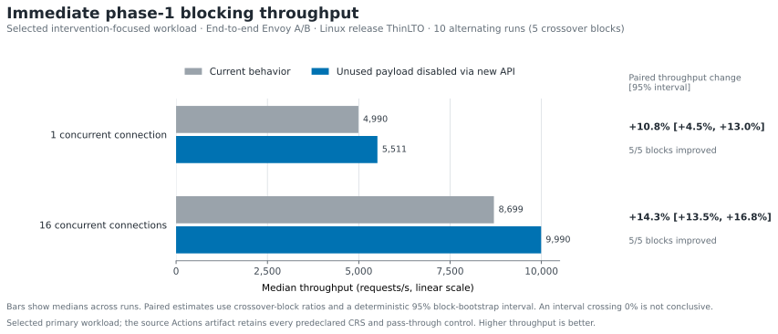

# Intervention log payload Envoy A/B

This experiment compares the current behavior, which builds the free-form intervention log
payload, with the proposed API call that disables payload generation when a connector does not
consume it. Both variants retain intervention status, redirects, and bounded structured rule
events.

<p align="center">
  
</p>

The chart and headline table intentionally show only the predeclared primary path: a real 403
intervention created immediately while request headers are processed. This isolates the affected
operation and shows it at one and 16 concurrent connections. The source Actions artifact retains
all six predeclared workloads, including full CRS SQL injection blocks and pass-through controls.

| Request path | Concurrent connections | Actual median throughput | Paired throughput change | Envoy CPU/request change | Repeated-block result |
| --- | ---: | ---: | ---: | ---: | --- |
| Immediate phase-1 deny | 1 | 4,990 → 5,511 requests/s | **10.9% higher** [4.6%, 13.0%] | **13.5% lower** [7.7%, 15.9%] | Improved in 5/5 blocks |
| Immediate phase-1 deny | 16 | 8,699 → 9,990 requests/s | **14.3% higher** [13.5%, 16.8%] | **12.5% lower** [11.8%, 14.4%] | Improved in 5/5 blocks |

`1` and `16` mean simultaneous persistent HTTP/1.1 client connections, not Envoy worker threads.
Envoy used one worker in every measurement. Each bracketed range is a deterministic 95%
crossover-block bootstrap interval. An interval that crosses zero does not establish a change.

## Source and scope

| Item | Recorded value |
| --- | --- |
| Source run | [GitHub Actions run 30689105354](https://github.com/upgle/envoy-modsecurity/actions/runs/30689105354) |
| Platform | Linux x86_64 GitHub-hosted runner |
| Build | Bazel `opt`, stripped, ThinLTO, no PGO |
| Repetition | 10 alternating-order process runs grouped into five order-reversed crossover blocks |
| Envoy placement | One worker pinned to CPU 0; clients pinned across CPUs 1–3 |
| Rules | 27 OWASP CRS rule files plus the phase-1 benchmark rule |
| Baseline dependency | `7ea9fefbe0ba409d8733b4d682c8c4c059cd028d` |
| Candidate dependency | `1e16589865de2d8d244741e0b9d219e59941bd80` |
| Actions artifact digest | `sha256:37aac0bd31593ffee64fade508f95499ba972fa59381e199fd47a2914a1c40ba` |

The intervals describe variation among the five crossover blocks on this runner. They do not
measure host-to-host uncertainty and should not be treated as production capacity guarantees.

## Reproduce the chart

The committed normalized snapshot keeps the plotted values after the Actions artifact expires.
Regenerate the SVG from that snapshot with Python and Matplotlib 3.10.5:

```shell
python3 -m venv .venv
.venv/bin/pip install --requirement tools/intervention-log-payload-chart-requirements.txt
.venv/bin/python tools/render-intervention-log-payload-chart.py \
  docs/performance/intervention-log-payload-ab-chart.json \
  --output docs/images/intervention-log-payload-ab-throughput.svg
```

To audit the normalization from the raw result while the Actions artifact is available:

```shell
gh run download 30689105354 \
  --repo upgle/envoy-modsecurity \
  --name intervention-log-payload-ab-linux-amd64 \
  --dir artifacts/intervention-log-payload-ab

.venv/bin/python tools/render-intervention-log-payload-chart.py \
  artifacts/intervention-log-payload-ab/intervention-log-payload-ab.json \
  --output docs/images/intervention-log-payload-ab-throughput.svg \
  --snapshot docs/performance/intervention-log-payload-ab-chart.json \
  --source-url https://github.com/upgle/envoy-modsecurity/actions/runs/30689105354 \
  --artifact-digest \
  sha256:37aac0bd31593ffee64fade508f95499ba972fa59381e199fd47a2914a1c40ba
```
